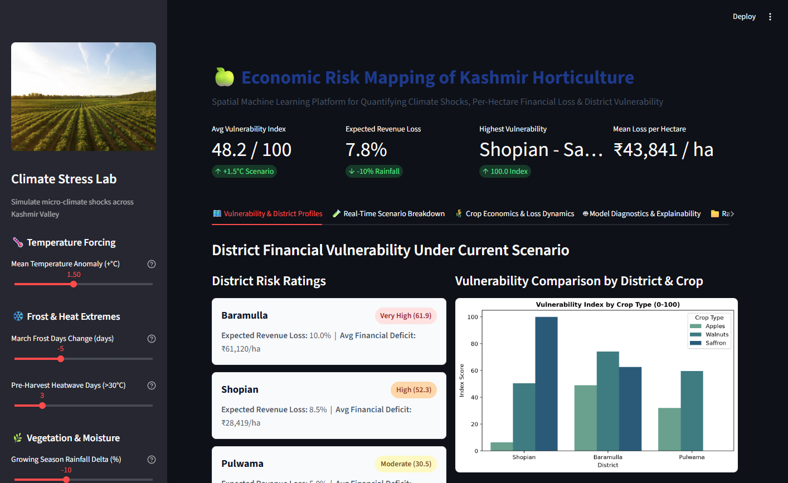

## Project Overview
Spatial machine learning model to predict per-hectare financial loss of cash crops (apples, walnuts, saffron) in Kashmir Valley based on micro-climate anomalies and geospatial vegetation indices.

### Focus Districts
- Shopian
- Baramulla
- Pulwama

### Target Variable
- Revenue per Hectare (or Financial Loss %)

### Data Sources (Synthetic during development)
- Climate Data: Daily/Monthly records
- Geospatial Data: NDVI scores, altitude
- Economic Data: Yearly/seasonal crop yields and prices

---

## Project Structure

```
economic_risk_mapping/
├── README.md
├── pyproject.toml                  # Build and package configuration
├── requirements.txt                # Core runtime dependencies
├── requirements-dev.txt            # Dev dependencies (pytest, jupyter, ruff)
├── config.yaml                     # Model training parameters
├── app.py                          # Interactive Streamlit dashboard
├── main.py                         # End-to-end pipeline execution
├── data/
│   ├── raw/
│   ├── processed/
│   └── synthetic/
├── src/
│   ├── __init__.py
│   ├── config.py                   # Centralized configuration dictionary
│   ├── data_generation.py          # Synthetic data creation
│   ├── data_preprocessing.py       # Merging, feature engineering
│   ├── model_training.py           # XGBoost pipeline with hyperparameter tuning
│   ├── model_evaluation.py         # Metrics, visualizations, vulnerability index
│   └── utils.py                    # Helper functions & logging
├── notebooks/
│   └── eda_and_analysis.ipynb      # Interactive exploratory data analysis
└── tests/                          # Automated unit and integration test suite
    ├── __init__.py
    ├── test_data_generation.py
    ├── test_data_preprocessing.py
    └── test_model_pipeline.py
```

---

## Installation & Setup

### Prerequisites
- Python 3.9+ (fully compatible through Python 3.14)
- pip or conda

### Install Dependencies
```bash
pip install -r requirements.txt
```

To install development & test dependencies:
```bash
pip install -r requirements-dev.txt
```

---

## Quick Start

### 1. Run the Complete Pipeline
```bash
python main.py
```

This will:
1. Generate synthetic datasets (climate, geospatial, economic)
2. Preprocess and engineer features
3. Train and tune an XGBoost model via 5-fold cross validation
4. Evaluate performance and generate visualizations
5. Calculate Financial Vulnerability Index for climate scenarios (+1.5°C and +2.0°C)

### 2. Launch Interactive Streamlit Dashboard
```bash
streamlit run app.py
```
Opens an interactive scenario laboratory at `http://localhost:8501` where users can:
- Adjust micro-climate forcing sliders (Temperature, Rainfall, Frost Days, Pre-harvest Heatwaves, NDVI stress)
- Re-run model inference on-the-fly and observe immediate changes to revenue loss
- Inspect district-level vulnerability heatmaps and download customized scenario reports as CSV



### 3. Run Automated Tests
```bash
python -m unittest discover -s tests -p "test_*.py" -v
```
Or if `pytest` is installed:
```bash
pytest tests/ -v
```

---

## Pipeline Stages

### 1. Data Generation (`data_generation.py`)
- **Climate Data**: Daily temperature (avg, max, min), precipitation
- **Geospatial Data**: NDVI scores, altitude, arable land percentage
- **Economic Data**: Crop yields, farm-gate prices, revenue per hectare
- **Output**: CSV files with realistic distributions

### 2. Data Preprocessing (`data_preprocessing.py`)
- Merge datasets on Date/Year and District
- Handle missing values and outliers
- **Feature Engineering**:
  - Frost Days in March (critical for blooming)
  - Pre-Harvest Heatwave (consecutive hot days)
  - NDVI Deviation (vs. 10-year rolling average)
  - Seasonal aggregates (temperature, precipitation)
  - Lag features for temporal patterns

### 3. Model Training (`model_training.py`)
- Train/Test split with temporal validation (train on past, test on future)
- XGBoost Regressor with GridSearchCV for hyperparameter tuning
- Cross-validation to prevent overfitting
- Model persistence (pickle)

### 4. Evaluation & Visualization (`model_evaluation.py`)
- **Metrics**: RMSE, MAE, R², MAPE
- **Plots**: Feature importance, prediction vs. actual, residuals
- **Financial Vulnerability Index**: 0-100 normalized score by district
- **Climate Scenario**: 1.5°C temperature increase impact

---

## Key Features

✅ **Temporal Splitting**: Ensures no data leakage (train on past years, test on future)  
✅ **Robust Feature Engineering**: Climate anomalies specific to horticulture  
✅ **Hyperparameter Tuning**: GridSearchCV with cross-validation  
✅ **Production-Ready Code**: Modular, well-documented, error handling  
✅ **Reproducibility**: Fixed random seeds, versioning  
✅ **Scalability**: Easy to integrate real datasets  

---

## Output Files

- `models/xgboost_model.pkl` — Trained model
- `results/evaluation_metrics.json` — Performance metrics
- `results/feature_importance.png` — Feature importance plot
- `results/vulnerability_index.csv` — Financial vulnerability by district
- `results/climate_scenario_impact.csv` — 1.5°C scenario projections

---

## Next Steps

1. **Integrate Real Data**: Replace synthetic data with actual climate, geospatial, and economic datasets
2. **Hyperparameter Refinement**: Tune based on real data distributions
3. **Spatial Analysis**: Add geospatial clustering (e.g., K-means by altitude zones)
4. **Model Ensembling**: Combine XGBoost with LightGBM or other algorithms
5. **Deployment**: REST API for real-time risk predictions
6. **Monitoring**: Track model drift and retraining frequency

---

## References

- XGBoost: https://xgboost.readthedocs.io/
- Scikit-Learn: https://scikit-learn.org/
- NDVI & Agricultural Monitoring: https://www.usgs.gov/faqs/what-ndvi
- Climate Data & Horticulture: FAO Agricultural Meteorology

---

## Author Notes

This pipeline is designed for exploratory development with synthetic data. As real datasets become available, update `data_generation.py` with actual data loaders and adjust feature engineering based on domain knowledge from agricultural experts in Kashmir Valley.
\n---\n**Author: Mujtaba Hyder**
